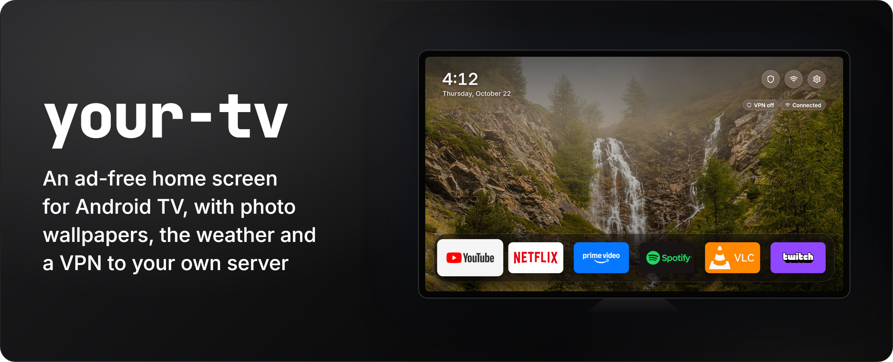
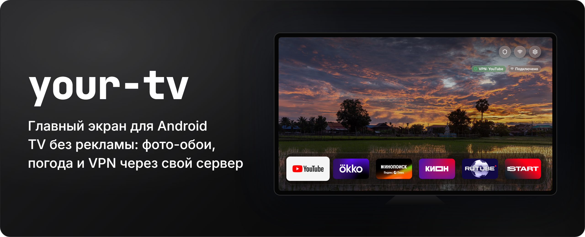

# your-tv



[](https://github.com/Melidovskiy/your-tv/actions/workflows/test.yml)
[](app/AndroidManifest.xml)
[](#requirements)
[](https://melidovskiy.github.io/your-tv/)
[](https://github.com/simbasjungles/free-my-tv)
[](LICENSE)

**English** · [Русский](#русский)

A fast, ad-free home screen for Android TV: no sponsored rows, banners or autoplaying promos, with photo wallpapers, the weather, and an optional VPN through your own proxy server.

Built on [Free My TV](https://github.com/simbasjungles/free-my-tv), an open-source home screen for Google TV and Android TV (MIT). Developed and tested on Xiaomi Mi TV 4S and 4A (Android 9). **The interface is in English or Russian**: it follows the TV's language, and *Screen Settings* → *Язык · Language* changes it.

> An independent project, not affiliated with Google, Xiaomi, YouTube, TMDB or any streaming service. Names and trademarks belong to their owners and are used only to describe compatibility.

## Contents

- [What it does](#what-it-does)
- [Requirements](#requirements)
- [Install](#install)
- [Settings](#settings)
- [Going back](#going-back)
- [Credits](#credits)
- [License](#license)

## What it does

- **A clean home screen.** Picks of trending films and shows from the streaming apps installed on your TV (Netflix, Prime Video, Disney+, Max, Apple TV and others; cartoons only now and then), a dock with your favorite apps followed by all the others, and a drawer with the inputs, shortcuts and a full-width weather card (now, the next hours, 3 days).
- **Photo wallpapers.** Landscapes from Wikimedia Commons' featured pictures, a new one every five minutes: bright ones by day, darker ones and sunsets in the evening, stars and northern lights from 21:00.
- **An evening look.** From sunset (no later than 20:00) to sunrise (no earlier than 7:00) the glass, buttons and wallpaper get a little darker.
- **A clock with the date** at the top left (beside the buttons when the recommendations are shown), 24-hour or 12-hour ("9:41"): it follows the TV's own setting, and *Screen Settings* → *Clock* changes it.
- **VPN, Wi-Fi and Settings buttons** at the top right, with status pills.
- **An optional VPN through your own server.** Paste any common share link: `vless://` (TCP, WebSocket, gRPC, HTTPUpgrade, xhttp; TLS or Reality), `vmess://`, `trojan://` or `ss://`, from any panel or provider (3X-UI, Marzban, Hiddify, Outline and others). The VPN button switches between YouTube only, the whole TV, and off; off stays off after a restart. Leave the link empty and there is no VPN.
- **YouTube without ads.** If [TizenTube](https://github.com/reisxd/TizenTubeCobalt) is installed, the YouTube tile opens it: YouTube's own TV interface without ads and sponsor segments.
- **Fewer ads and trackers.** The stock home screen and its promo apps are turned off (not uninstalled), AdGuard DNS blocks ad domains for every app, and system animations run twice as fast. The list of apps to turn off was made on a Xiaomi TV: on other brands, review it first (`app/src/io/freemytv/Debloat.java`).
- **A dock you edit with the remote.** Hold OK on an app: pick the first six, change the order, or hide apps.

## Requirements

- An Android TV or Google TV (Android 9 or newer) with **USB debugging** on.
- A computer on the same network with a JDK 17, the Android SDK command-line tools (build-tools 34, platform 34) and `adb`. The scripts are bash (Linux, macOS, or Git Bash on Windows).
- Optional: a free [TMDB](https://www.themoviedb.org/settings/api) key for the picks, and a share link to your own proxy server for the VPN.

## Install

1. **On the TV**, turn on developer mode: Settings → Device Preferences → About → press *Build* 7 times. Then Developer options → turn on **USB debugging**. Write down the TV's IP address (Settings → Network & Internet).
2. **On your computer**, get the code and the libraries:
   ```bash
   git clone https://github.com/Melidovskiy/your-tv && cd your-tv
   tools/fetch_libs.sh     # the Xray core and a test library, checked by sha256
   ./build.sh              # the first run creates config.properties
   ```
3. **Fill in `config.properties`** (see [Settings](#settings)), then build:
   ```bash
   ./test.sh && ./build.sh
   ```
4. **Install:**
   ```bash
   adb connect <TV IP>:5555
   adb install -r FreeMyTV.apk
   ```
   The TV asks *Allow USB debugging?*: tick *Always allow* and press OK.
5. **On the TV**, open the app *Home Screen* (*Главный экран* on a TV set to Russian) → *Home Screen* → *New*, and allow USB debugging once more (the app uses the TV's own ADB to switch).

Keep `freemytv.keystore`, which the first build creates: updates must be signed with it.

## Settings

`config.properties` stays on your computer and out of git. The TMDB key and the proxy link are secrets: don't publish them.

| Key | What it does | Default |
|---|---|---|
| `tmdb_key` | TMDB key for the picks | empty |
| `tmdb_region` | Your country, two letters: which titles are on which app | `US` |
| `latitude`, `longitude`, `city` | Your city, for the weather and the night look | New York |
| `temperature` | `C`, `F` or `auto` | `auto` |
| `disable_assistant` | Also turn off Google Assistant | `false` |
| `proxy_link` | Your proxy server's share link, for the VPN | empty |

## Going back

On the TV: *Home Screen* → *Home Screen* → *Original*. The stock home screen, screensaver and apps come back, along with the DNS, animation and VPN settings. If the new home screen crashes three times in five minutes, it switches back by itself.

## Credits

- **[Free My TV](https://github.com/simbasjungles/free-my-tv)** by simbasjungles (MIT): the home screen, screensaver, settings, the switch through the TV's own ADB, and the crash safety net this project is built on.
- **[Xray-core](https://github.com/XTLS/Xray-core)** via **[AndroidLibXrayLite](https://github.com/2dust/AndroidLibXrayLite)** (MPL-2.0): the VPN engine, downloaded at build time.
- **[TizenTube Cobalt](https://github.com/reisxd/TizenTubeCobalt)** by reisxd: the YouTube client the YouTube tile opens; not included.
- Icons: [Material Symbols](https://fonts.google.com/icons) (Apache 2.0) and [Lucide](https://lucide.dev) (ISC). Font: [Inter](https://rsms.me/inter/) (SIL OFL 1.1).
- Wallpapers: featured pictures from [Wikimedia Commons](https://commons.wikimedia.org); each photo's author and license are in `app/assets/wallpapers.json`. In the banners: [a waterfall above Gimillan](https://commons.wikimedia.org/wiki/File:Bergtocht_van_Gimillan_(1805m.)_naar_Colle_Tsa_S%C3%A8tse_in_Cogne_Valley_(Itali%C3%AB)._Waterval_boven_Gimillan_gedeeltelijk_in_de_mist_03.jpg) by Dominicus Johannes Bergsma and [a paddy field at dusk in Don Det](https://commons.wikimedia.org/wiki/File:Colorful_sky_with_orange_and_pink_clouds_reflecting_in_the_water_of_a_paddy_field_at_dusk_in_Don_Det_Laos.jpg) by Basile Morin, both [CC BY-SA 4.0](https://creativecommons.org/licenses/by-sa/4.0/). App logos belong to their owners.
- Weather: [Open-Meteo](https://open-meteo.com/) (CC BY 4.0). This product uses the TMDB API but is not endorsed or certified by [TMDB](https://www.themoviedb.org/).

Full list and license texts: [NOTICE.md](NOTICE.md).

## License

[MIT](LICENSE). Free My TV's copyright notice is kept; the changes are the author of this project's.

The project only changes the TV's settings through its own ADB and turns apps off with Android's own commands. It is not meant to get around DRM, paid features or any other access control. You are responsible for following the terms of your TV, the services you use and your proxy server, and the laws of your country. Provided "as is", without warranty.

---

# Русский



**Русский** · [English](#your-tv)

Быстрый главный экран для Android TV без рекламы: никаких рекламных рядов, баннеров и автозапуска роликов. С фотообоями, погодой и VPN через ваш собственный прокси-сервер (по желанию).

Основан на [Free My TV](https://github.com/simbasjungles/free-my-tv) — открытом главном экране для Google TV и Android TV (лицензия MIT). Разработан и проверен на Xiaomi Mi TV 4S и 4A (Android 9). Интерфейс на русском или английском: по языку телевизора, сменить — «Настройки экрана» → «Язык · Language».

> Проект независимый и не связан с Google, Xiaomi, YouTube, TMDB или какими-либо онлайн-кинотеатрами. Названия и товарные знаки принадлежат их правообладателям и используются только для указания совместимости.

## Содержание

- [Что умеет](#что-умеет)
- [Что понадобится](#что-понадобится)
- [Установка](#установка)
- [Настройки](#настройки)
- [Как вернуть всё обратно](#как-вернуть-всё-обратно)
- [Основано на](#основано-на)
- [Лицензия](#лицензия)

## Что умеет

- **Чистый главный экран.** Подборка популярных фильмов и сериалов из онлайн-кинотеатров, установленных на вашем телевизоре (например, Кинопоиск, Okko, Wink, KION, ivi — у каждого свой набор; мультфильмы — лишь изредка), док с избранными приложениями и всеми остальными, нижняя панель со входами, ярлыками и погодой на всю ширину: сейчас, ближайшие часы и три дня.
- **Фотообои.** Пейзажи из избранных фотографий Wikimedia Commons, новые каждые пять минут: днём светлые, вечером темнее и закаты, с 21:00 звёзды и северное сияние.
- **Вечерний вид.** С заката (но не позже 20:00) до рассвета (но не раньше 7:00) стекло, кнопки и обои становятся чуть темнее.
- **Часы с датой** в левом верхнем углу (рядом с кнопками, если показаны рекомендации), в 24- или 12-часовом формате («9:41»): по настройке телевизора, сменить — «Настройки экрана» → «Часы».
- **Кнопки VPN, Wi-Fi и «Настройки»** в правом верхнем углу и плашки с их состоянием.
- **VPN через свой сервер — по желанию.** Подойдёт любая распространённая ссылка: `vless://` (TCP, WebSocket, gRPC, HTTPUpgrade, xhttp; TLS или Reality), `vmess://`, `trojan://` или `ss://` — из любой панели или от любого провайдера (3X-UI, Marzban, Hiddify, Outline и другие). Кнопка VPN переключает: только YouTube, весь телевизор, выключен; выключенный VPN остаётся выключенным и после перезагрузки. Без ссылки VPN просто не включается.
- **YouTube без рекламы.** Если установлен [TizenTube](https://github.com/reisxd/TizenTubeCobalt), плитка YouTube открывает его — родной интерфейс YouTube для ТВ без рекламы и спонсорских вставок.
- **Меньше рекламы и слежки.** Заводской главный экран и его рекламные приложения отключаются (не удаляются), DNS AdGuard блокирует рекламные адреса для всех приложений, анимации системы становятся вдвое быстрее. Список отключаемых приложений составлен для телевизора Xiaomi: на других марках сначала проверьте его (`app/src/io/freemytv/Debloat.java`).
- **Док настраивается с пульта.** Удерживайте OK на приложении: первые шесть мест, порядок, скрытие.

## Что понадобится

- Телевизор или приставка на Android TV или Google TV (Android 9 и новее) с включённой **отладкой по USB**.
- Компьютер в той же сети: JDK 17, Android SDK (build-tools 34, platform 34) и `adb`. Скрипты написаны для bash (Linux, macOS или Git Bash в Windows).
- По желанию: бесплатный ключ [TMDB](https://www.themoviedb.org/settings/api) для подборки и ссылка на свой прокси-сервер для VPN.

## Установка

1. **На телевизоре** включите режим разработчика: Настройки → Настройки устройства → Об устройстве → нажмите *Сборка* 7 раз. Затем «Для разработчиков» → включите **Отладку по USB**. Запишите IP-адрес телевизора (Настройки → Сеть и Интернет).
2. **На компьютере** скачайте код и библиотеки:
   ```bash
   git clone https://github.com/Melidovskiy/your-tv && cd your-tv
   tools/fetch_libs.sh     # ядро Xray и библиотека для тестов, с проверкой sha256
   ./build.sh              # первый запуск создаёт config.properties
   ```
3. **Заполните `config.properties`** (см. [Настройки](#настройки)) и соберите:
   ```bash
   ./test.sh && ./build.sh
   ```
4. **Установите:**
   ```bash
   adb connect <IP телевизора>:5555
   adb install -r FreeMyTV.apk
   ```
   Телевизор спросит «Разрешить отладку по USB?»: отметьте «Всегда разрешать» и нажмите OK.
5. **На телевизоре** откройте приложение «Главный экран» → «Главный экран» → «Новый» и ещё раз разрешите отладку по USB (приложение переключает режимы через ADB самого телевизора).

Сохраните файл `freemytv.keystore`, который создаёт первая сборка: обновления нужно подписывать тем же ключом.

## Настройки

`config.properties` остаётся на вашем компьютере и не попадает в git. Ключ TMDB и ссылка на прокси — секреты: не публикуйте их.

| Параметр | Что делает | По умолчанию |
|---|---|---|
| `tmdb_key` | Ключ TMDB для подборки | пусто |
| `tmdb_region` | Ваша страна, две буквы (`RU`, `US`, `DE`…): что где показывают | `US` |
| `latitude`, `longitude`, `city` | Ваш город: погода и ночной вид | Нью-Йорк |
| `temperature` | `C`, `F` или `auto` | `auto` |
| `disable_assistant` | Отключить и Google Ассистента | `false` |
| `proxy_link` | Ссылка на ваш прокси-сервер для VPN | пусто |

## Как вернуть всё обратно

На телевизоре: «Главный экран» → «Главный экран» → «Заводской». Вернутся заводской главный экран, заставка и приложения, а также настройки DNS, анимаций и VPN. Если новый главный экран упадёт три раза за пять минут, телевизор сам вернётся к заводскому.

## Основано на

- **[Free My TV](https://github.com/simbasjungles/free-my-tv)** by simbasjungles (MIT): главный экран, заставка, настройки, переключение через ADB самого телевизора и защита от сбоев — основа проекта.
- **[Xray-core](https://github.com/XTLS/Xray-core)** через **[AndroidLibXrayLite](https://github.com/2dust/AndroidLibXrayLite)** (MPL-2.0): ядро VPN, скачивается при сборке.
- **[TizenTube Cobalt](https://github.com/reisxd/TizenTubeCobalt)** by reisxd: клиент YouTube, который открывает плитка YouTube; в проект не входит.
- Иконки: [Material Symbols](https://fonts.google.com/icons) (Apache 2.0) и [Lucide](https://lucide.dev) (ISC). Шрифт: [Inter](https://rsms.me/inter/) (SIL OFL 1.1).
- Обои: избранные фотографии [Wikimedia Commons](https://commons.wikimedia.org); автор и лицензия каждой — в `app/assets/wallpapers.json`. На баннерах: [водопад над Жимийаном](https://commons.wikimedia.org/wiki/File:Bergtocht_van_Gimillan_(1805m.)_naar_Colle_Tsa_S%C3%A8tse_in_Cogne_Valley_(Itali%C3%AB)._Waterval_boven_Gimillan_gedeeltelijk_in_de_mist_03.jpg), автор Dominicus Johannes Bergsma, и [рисовое поле на закате в Дон Дете](https://commons.wikimedia.org/wiki/File:Colorful_sky_with_orange_and_pink_clouds_reflecting_in_the_water_of_a_paddy_field_at_dusk_in_Don_Det_Laos.jpg), автор Basile Morin, обе — [CC BY-SA 4.0](https://creativecommons.org/licenses/by-sa/4.0/). Логотипы приложений принадлежат их владельцам.
- Погода: [Open-Meteo](https://open-meteo.com/) (CC BY 4.0). Продукт использует TMDB API, но не одобрен и не сертифицирован [TMDB](https://www.themoviedb.org/).

Полный список и тексты лицензий — в [NOTICE.md](NOTICE.md).

## Лицензия

[MIT](LICENSE). Уведомление об авторских правах Free My TV сохранено; изменения принадлежат автору этого проекта.

Проект меняет только настройки телевизора через его собственный ADB и отключает приложения стандартными командами Android. Он не предназначен для обхода DRM, платных функций или иных механизмов контроля доступа. Пользователь сам отвечает за соблюдение условий телевизора, используемых сервисов и своего прокси-сервера, а также законов своей страны. Проект предоставляется «как есть», без гарантий.
